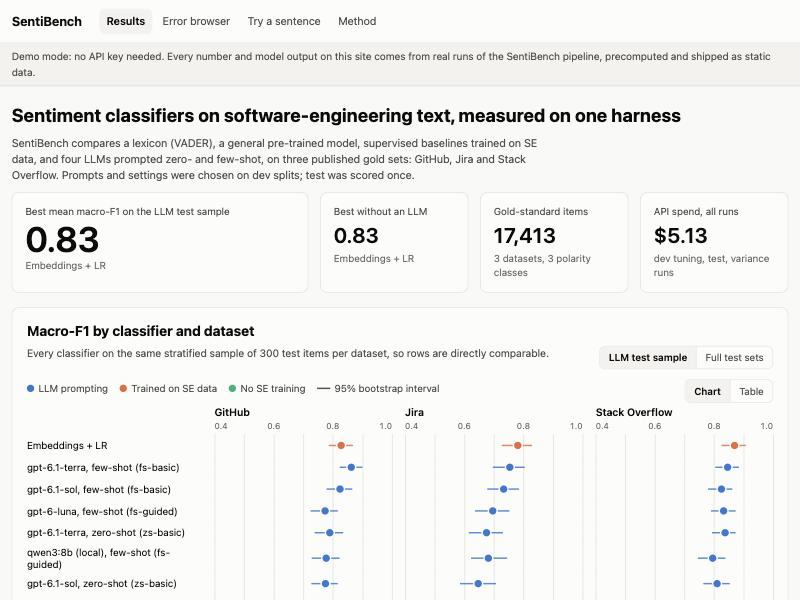

# SentiBench

An evaluation harness for sentiment classifiers on software-engineering text.
It puts a lexicon (VADER), a general pre-trained model, supervised baselines
trained on SE data, and four LLMs prompted zero- and few-shot on the same
three published gold sets (GitHub, Jira, Stack Overflow), with the same
splits and metrics, and reports accuracy with bootstrap intervals,
cross-platform transfer, cost per 1,000 items, latency, failure rate,
run-to-run variance and an error analysis.



## The problem

Sentiment tools are widely used in software-engineering research and
tooling, and the evidence on which tool to use is scattered. In the mapping
study this project builds on (*Emotions in Software Engineering*, 57
studies), the cell **emotion recognition tools × cross-phase** holds 10
studies, and they are fragmented: each proposes or compares one or two tools
on its own data (Jongeling et al. 2017; Calefato et al. 2018; Novielli et al.
2018; Imtiaz et al. 2018; Lin et al. 2018; Novielli et al. 2020, among
others). General-purpose tools misread technical vocabulary ("kill the
process"), SE-specific tools lose accuracy on other platforms, and LLMs have
been added to the comparison only recently (Zhang et al. 2025). Someone
choosing a classifier today also needs the price per item and how stable an
LLM's labels are between runs, next to accuracy.

SentiBench is that side-by-side view, built the way an LLM evaluation should
be: prompts chosen on dev, test scored once, intervals on every number,
failures counted, every run cached and resumable, and spend reported.

## Research basis

- Map cell: **Tools × Cross-phase** (10 studies, fragmented), from the
  author's systematic mapping study of 57 papers.
- Gold sets and their annotation scheme: Novielli et al. 2020 (GitHub), Ortu et
  al. 2016 (Jira), Calefato et al. 2018 (Stack Overflow); polarity from Shaver
  et al.'s (1987) emotion framework.
- Known failure modes it tests: technical vocabulary (Jongeling et al. 2017;
  Novielli et al. 2018), politeness and dataset conventions (Novielli et al.
  2020), cross-platform transfer (Novielli et al. 2020), LLMs against
  supervised models (Zhang et al. 2025).
- What it does not do: score people. It classifies text artefacts. Inferring
  workers' emotions with AI is prohibited in the EU workplace (AI Act, Art.
  5(1)(f)), and expressed sentiment is a cue, not a readout of an inner state
  (Barrett et al. 2019). The claims here are "grounded in" this literature,
  not "validated".

Full references are in [docs/benchmark.md](docs/benchmark.md#references).

## What it does

| Part | What |
|---|---|
| `sentibench fetch`, `prepare` | Downloads the three gold sets (checksummed), cleans them, writes fit/dev/test splits and a stratified sample order |
| `sentibench baselines` | VADER (default and dev-tuned thresholds), RoBERTa-Twitter (`--roberta`), TF-IDF + logistic regression, embeddings + logistic regression; hyperparameters chosen on dev |
| `sentibench llm` | LLM classification with strict JSON output through OpenAI or Ollama; per-item cache on disk, resumable, failures recorded and counted, a hard spend cap (`--budget`) |
| `sentibench examples` | The selected classifiers on the demo's example sentences |
| `sentibench report` | Applies the dev selection rule, computes every table (macro-F1, per-class F1, κ, bootstrap CIs, paired differences, cross-platform, cost, variance, agreement, error tags) into [docs/benchmark.md](docs/benchmark.md), and exports the web demo's data and browser models |
| `sentibench resume` | Finishes every planned run that is incomplete (only the missing items), then the examples, then rebuilds the report |
| `sentibench classify "…"` | One sentence through VADER, TF-IDF and optionally an LLM |
| `web/` | Next.js static site: results dashboard, error browser, an offline try-a-sentence box, method page, Research basis and Limitations panels |

## Results

Macro-F1 on the LLM test sample: the same 300 stratified test items per
dataset for every classifier. Full tables, per-class F1, κ, bootstrap
intervals, paired differences and the error analysis are in
[docs/benchmark.md](docs/benchmark.md).

| Classifier | GitHub | Jira | Stack Overflow | Mean | USD per 1,000 items |
|---|---|---|---|---|---|
| Embeddings + LR (trained per dataset) | 0.83 | 0.78 | 0.87 | **0.83** | 0.0006 |
| `gpt-6.1-terra`, few-shot | 0.86 | 0.75 | 0.85 | 0.82 | 0.49 |
| `gpt-6.1-sol`, few-shot | 0.82 | 0.73 | 0.83 | 0.79 | 0.91 |
| `gpt-6.1-terra`, zero-shot | 0.79 | 0.68 | 0.84 | 0.77 | 0.27 |
| `qwen3:8b` (local), few-shot | 0.78 | 0.68 | 0.80 | 0.75 | 0 (0.56 s per item on a laptop) |
| TF-IDF + LR (trained per dataset) | 0.67 | 0.79 | 0.75 | 0.74 | 0 |
| `gpt-6.1-sol`, zero-shot | 0.78 | 0.65 | 0.81 | 0.74 | 0.43 |
| RoBERTa-Twitter (no SE training) | 0.77 | 0.68 | 0.75 | 0.73 | 0 |
| `gpt-6-luna`, zero-shot | 0.80 | 0.57 | 0.81 | 0.73 | 0.05 |
| `qwen3:8b` (local), zero-shot | 0.77 | 0.61 | 0.82 | 0.73 | 0 |
| VADER, dev-tuned thresholds | 0.63 | 0.67 | 0.83 | 0.71 | 0 |
| VADER | 0.60 | 0.58 | 0.75 | 0.64 | 0 |

Headlines:

- **Embeddings + logistic regression trained on the SE split is as good as the
  best LLM and about 800 times cheaper.** `gpt-6.1-terra` few-shot is within
  ±0.04 of it on every dataset (paired intervals include zero).
- **Jira separates prompting from training**: zero-shot LLMs score 0.57 to 0.68
  there against 0.78 to 0.79 for supervised baselines, because Jira's labels
  follow conventions (thanks for a patch is positive, an apology negative).
  Nine in-domain examples add about +0.08.
- **`gpt-6.1-terra` matches or beats `gpt-6.1-sol` at half the price.**
- **`gpt-6.1-terra` and `gpt-6.1-sol` agree with each other (κ 0.83 to 0.88)
  more than with the gold labels (0.63 to 0.74)**, which says as much about
  annotation conventions as about the models.
- **VADER calls 81 % of technical-vocabulary items negative** ("problem
  happened in the CI server"); RoBERTa-Twitter 49 %, LLMs and supervised models
  18 to 26 %.
- Prompt rules written for one convention hurt the large models on another
  (dev): a politeness rule dropped `gpt-6.1-sol` from 0.82 to 0.57 on Jira dev.
  Few-shot examples without rules worked best for them.
- Strict JSON schemas: no invalid outputs in 11,919 test calls.
- Run-to-run variance (local `qwen3:8b`, three runs, default sampling): 1.3 %
  of labels changed zero-shot, 3.3 % few-shot; macro-F1 moved by up to 0.03.

**API spend: $3.42** (dev tuning $1.10, test $2.32, embeddings $0.01, plus a
few unrecorded probe calls under $0.01), under the $6 budget. **Not done: OpenAI credits ran out.** The shared API account
ran out of credits during the test runs, so `gpt-6-luna` few-shot, the repeated
runs for the three API models, half of the cross-platform LLM cells and the
API models' outputs on the demo's example sentences are missing; nothing was
estimated in their place (see "Not done" below).

## Quick start

Python 3.13 with [uv](https://docs.astral.sh/uv/); Node 24 for the web demo.

```bash
uv sync
uv run pytest
```

Web demo in sample-data mode (no API key; all data is precomputed from real
runs and committed in `web/public/data/`):

```bash
cd web && npm install && npm run build && npx serve out
```

`npm run dev` serves it at http://localhost:3000 for development, and
`npm run parity` checks the browser VADER and TF-IDF against the Python ones
on all 5,221 test items.

Re-running the benchmark needs `OPENAI_API_KEY` (read from `.env` here or
from `../elicitsense/.env`, without overriding a key already set) and, for the
local model, `ollama serve` with `qwen3:8b`:

```bash
uv sync --extra hf                       # torch + transformers for RoBERTa (~500 MB model download)
uv run sentibench fetch && uv run sentibench prepare
uv run sentibench baselines --roberta
uv run sentibench llm -m openai:gpt-6-luna ollama:qwen3:8b -p zs-basic zs-guided fs-basic fs-guided --split dev -n 150
uv run sentibench llm -m openai:gpt-6.1-terra openai:gpt-6.1-sol -p zs-basic zs-guided fs-basic fs-guided --split dev -n 60
uv run sentibench llm -m openai:gpt-6-luna -p zs-guided fs-guided --split test
uv run sentibench llm -m openai:gpt-6.1-terra openai:gpt-6.1-sol -p zs-basic fs-basic --split test -n 300
uv run sentibench llm -m ollama:qwen3:8b -p zs-guided fs-guided --split test -n 300
uv run sentibench llm -m openai:gpt-6-luna openai:gpt-6.1-terra openai:gpt-6.1-sol ollama:qwen3:8b \
  -p <selected prompts> --split test -n 100 --runs 2 --first-run 2
uv run sentibench examples && uv run sentibench report
```

The test commands use the prompts the dev selection rule picked; `report`
checks that they match and stops if a selected configuration is missing.

## Not done

- **Not done: OpenAI credits ran out.** The shared OpenAI account ran out of
  credits during the test runs. Missing: `gpt-6-luna` few-shot (121 of 900
  sample items, 863 of 5,221 full-test items), runs 2 and 3 of the variance
  study for `gpt-6-luna`, `gpt-6.1-terra` and `gpt-6.1-sol` (the local
  `qwen3:8b` variance runs are complete), three of the six `gpt-6-luna`
  cross-platform cells, and the API models' outputs on the try-box example
  sentences (Embeddings + LR too, since it needs the embeddings API). Billing
  errors were not counted as model failures, and the report and demo show
  only completed runs. Once credits are added, one command finishes the
  missing items (finished ones are cached) and rebuilds the report and demo
  data; it can be repeated safely if it stops again:

  ```bash
  uv run sentibench resume
  ```
- Not deployed: the site builds as a static export for Vercel, but there is no
  account.
- SentiStrength-SE and Senti4SD were not run (no Python package); no
  transformer was fine-tuned on the SE data.

## Limitations

- Classifies text, not people; see Research basis.
- The expensive models were scored on 300 test items per dataset; differences
  under about 0.05 macro-F1 are not resolved (paired intervals in the report).
- Gold labels encode each dataset's conventions (e.g. thanks for a patch is
  positive in Jira, neutral elsewhere); some "errors" are convention mismatches.
- The GitHub split is a seeded 70/30 split, not the authors'; 111 Jira test
  texts also occur in train.
- LLM outputs vary between runs and API models can change behind the same name.
- SentiStrength-SE and Senti4SD were not run (no Python package).
- The try-box example sentences are synthetic and have no gold label.

More in [docs/benchmark.md](docs/benchmark.md#limitations).

## Datasets and licences

| Dataset | Source | Licence | Size | Split used |
|---|---|---|---|---|
| GitHub gold standard (7,122 comments) | Novielli et al. 2020, [figshare 10.6084/m9.figshare.11604597](https://doi.org/10.6084/m9.figshare.11604597) (`github_gold.csv`) | CC BY 4.0 | 978 KB | seeded stratified 70/30 |
| Jira polarity (5,869 comments; 1 empty dropped) | Ortu et al. 2016, polarity version in [collab-uniba/EMTK_datasets](https://github.com/collab-uniba/EMTK_datasets) `jira/emotions/{train,test}_jira.csv` | MIT (repository); cite Ortu et al. 2016 | 650 KB | official |
| Stack Overflow polarity (4,423 posts) | Calefato et al. 2018 (Senti4SD), [collab-uniba/EMTK_datasets](https://github.com/collab-uniba/EMTK_datasets) `so/polarity/` | MIT (repository); cite Calefato et al. 2018 | 810 KB | official |

The EMTk files are pinned to commit `2592acc` and all five files are
checked against MD5 sums (`sentibench/data.py`). Raw files are not committed;
the cleaned splits in `data/processed/` are, with the attribution above. The
web demo shows dataset texts with @handles and e-mail addresses masked.

Models: VADER lexicon (vaderSentiment 3.3.2, MIT);
[`cardiffnlp/twitter-roberta-base-sentiment-latest`](https://huggingface.co/cardiffnlp/twitter-roberta-base-sentiment-latest)
(CC BY 4.0, 501 MB, downloaded to the Hugging Face cache, not committed);
OpenAI `text-embedding-3-small`, `gpt-6-luna`, `gpt-6.1-terra`, `gpt-6.1-sol`;
`qwen3:8b` through Ollama.

## Layout

```
sentibench/      data, classifiers, prompts, llm (OpenAI + Ollama), bench (cached runs), metrics, analysis, report, cli
tests/           pytest suite
data/processed/  cleaned splits, stratified sample order, manifest
data/examples.json  synthetic demo sentences (no gold labels)
docs/            benchmark.md (generated from benchmark.template.md)
web/             Next.js static demo; lib/vader.ts and lib/tfidf.ts are the browser ports
runs/            run cache: predictions, call logs, embeddings, model selection (not committed)
```
